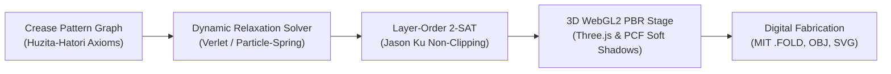

<div align="center">

# Project O2


### Computational Origami & Compliant 3D Kinematics Studio

An open-source, high-performance browser platform for real-time 3D origami kinematics, physical paper mechanics simulation, and computational crease pattern design.

[](LICENSE)
[](https://www.typescriptlang.org/)
[](https://react.dev/)
[](https://threejs.org/)
[](https://vitejs.dev/)
[](https://www.khronos.org/webgl/)
[](https://vitest.dev/)

[Quickstart](#quickstart) • [Architecture](#architecture) • [Features](#key-capabilities) • [Kinematics](#computational-kinematics) • [Hardware Setup](#hardware--display-setup) • [Documentation](#documentation-suite)

</div>

---

## Overview

**Project O2** is an interactive computational origami engine built from the ground up for modern web platforms. Combining rigorous mathematical folding theory (Huzita-Hatori axioms 1–7, Kawasaki's alternating sector theorem, Maekawa's parity theorem) with particle-spring dynamic relaxation and 3D WebGL rendering, O2 enables engineers, researchers, and origami practitioners to explore, simulate, and fabricate complex 3D folded structures in real time.

The studio features **63 fully verified origami models** across 9 cultural collections, authentic 24-facet photorealistic geometry, dual-sided paper PBR materials, multilingual hands-free audio narration, and native support for W3C foldable device postures.



---

## Key Capabilities

### 1. 3D Studio Showroom & Real-Time Turntable
* **Interactive 360° Inspection**: Smooth orbital rotation, panning, and zoom around the completed 3D folded sculpture before initiating step-by-step folding.
* **Dimensional Specifications**: Instant readout of Kami paper dimensions (e.g., 15×15 cm), estimated folding duration, difficulty tier, and micro-step count.
* **One-Click Studio Transition**: Instant switch between revolving showroom preview and step-by-step dihedral folding sequences.

### 2. Photorealistic PBR Paper Simulation
* **24-Facet Sculpted Geometry**: Authentic multi-facet geometric structures (such as the 24-facet Japanese Peace Crane with volumetric neck crimp, angled tail, cambered wings, and hollow pleated base).
* **Photographic Three-Point Lighting**: Calibrated warm key light (`1.25`, `#fffbf0`), soft fill light (`0.35`, `#e2e8f0`), and glancing rim/kicker light (`0.75`, `#fff5ea`).
* **Self-Shadowing & Contact Plinth**: High-fidelity `PCFSoftShadowMap` enabling facets to cast soft, contact-accurate shadows onto lower layers and the radial tabletop base.
* **Dual-Sided Paper Fiber Bump Texture**: Offscreen procedural high-frequency noise map rendering tactile paper fibers with distinct front/back coloration.

### 3. Multilingual Hands-Free Audio Guidance
* **Web Speech API Integration**: Localized synthesized speech across 5 languages:
  * English (`en`), Spanish (`es`), Japanese (`ja`), French (`fr`), and Hindi (`hi`).
* **Geometric & Physical Metaphors**: Context-aware fold descriptions (Diagonal Valley, Squash Fold, Inside-Reverse Crimp, Petal Fold).
* **Automatic Voice Progression**: Hands-free auto-speak option reads instructions upon step changes, freeing hands to fold physical paper.

### 4. Computational Kinematics & Solvers
* **Particle-Spring Dynamic Relaxation**: Web Worker-offloaded mass-spring solver simulating sheet compliance, strain energy minimization, and dihedral angle targets.
* **Thick-Panel Gusset Clearance**: Continuous smoothstep clearance preventing geometric self-intersection in thick cardstock ($w = 2t \csc(\theta/2)$).
* **Paper Grain Anisotropy**: Directional bending stiffness tensor modeling machine-direction resistance differentials ($E_\perp / E_\parallel \approx 1.80$).
* **Jason Ku (MIT) Layer-Order 2-SAT**: Non-clipping facet stack resolution ensuring proper over/under elevations across multiple layered folds.

### 5. Living Kinematic Companions
* **Procedural 2D Kinematic Canvas Rigs**: Autonomous multi-joint characters rendered directly onto HTML5 canvas with dynamic limb articulation, walking cycles, and responsive fold reactions.
* **Zero WebGL Overhead**: Companions run asynchronously on a lightweight 2D canvas layer without degrading 3D GPU frame rates.

### 6. Interoperability & Fabrication Exporters
* **MIT FOLD v1.1 Open Specification**: Universal JSON export of vertices, edges, fold assignments (Mountain `M`, Valley `V`, Boundary `B`, Unassigned `U`), and face graphs.
* **Wavefront 3D OBJ Exporter**: Direct 3D mesh export for CAD rendering, 3D printing, and finite element modeling (FEM).
* **Cricut & Laser Plotter SVG**: Dual-layer vector files formatted for automated scoring (Mountain/Valley kiss-cuts) and perimeter cutting.

---

## Quickstart

### Prerequisites
* [Node.js](https://nodejs.org/) v20.0.0 or higher
* [pnpm](https://pnpm.io/) v9.0.0 or higher
* A modern browser with WebGL2 support (Chrome 90+, Firefox 90+, Safari 16+, Edge 90+)

### Installation & Launch

```bash
# 1. Clone the repository
git clone https://github.com/ajayspi/O2.git
cd O2

# 2. Install workspace dependencies
pnpm install

# 3. Start local development server
pnpm dev
```

The application will be live at `http://localhost:5175/`.

### Verification & Testing

```bash
# Run unit test suite (Vitest)
pnpm test

# Run strict TypeScript compile checks & production build
pnpm build

# Execute automated 63-kit geometric validation
pnpm verify:kits
```

---

## Repository Structure

```
O2/
├── docs/                                # Technical documentation suite
│   ├── PREREQUISITES.md                 # System requirements, GPU, and runtime setup
│   ├── HARDWARE_DEVICE_SETUP.md         # Foldable devices, dual-screen, and hotkeys
│   ├── COMPUTATIONAL_KINEMATICS.md      # Mathematical foundations & physics solver
│   ├── CULTURAL_CATALOG.md              # 63 verified models across 9 collections
│   ├── ARCHITECTURE.md                  # State machines, rendering, and audio topology
│   └── CONTRIBUTING.md                  # Development guidelines and PR standards
├── origamistudio/                       # Production React 19 / TypeScript application
│   ├── src/
│   │   ├── components/                  # UI components, StudioView, 3D viewers, canvas rigs
│   │   ├── hooks/                       # Web Audio, TTS narration, and device posture hooks
│   │   ├── store/                       # Zustand 5 global state management
│   │   ├── types/                       # TypeScript interfaces (OrigamiKit, CreaseGraph)
│   │   ├── utils/                       # Kinematics solvers, 24-facet geometry, paper physics
│   │   └── workers/                     # Web Workers for dynamic relaxation simulation
│   ├── scripts/                         # Kit verification and automated screenshot harnesses
│   └── package.json                     # Application dependencies and Vite configuration
├── package.json                         # Workspace root script orchestration
├── pnpm-workspace.yaml                  # pnpm multi-package workspace definition
└── LICENSE                              # MIT License
```

---

## Hardware & Display Setup

Project O2 is optimized for a wide spectrum of physical workstations, mobile devices, and projection hardware:

* **Dual-Screen & Foldable Hardware**: Integrates the **W3C Foldable Device Posture API** to dynamically separate the 3D paper stage onto one screen and the control radar onto the secondary screen when folded into tent or book posture.
* **Presentation Mode**: Launch with `/?mode=presentation` to enable dual-window state synchronization for multi-display setups.
* **Gross-Motor Tactile Hotkeys**: Full keyboard navigation (`Spacebar` to toggle animation, `Arrow Right` for next fold, `Arrow Left` for undo, `M` to mute, `R` to reset).

See [HARDWARE_DEVICE_SETUP.md](docs/HARDWARE_DEVICE_SETUP.md) for full configuration guidelines.

---

## Documentation Suite

Detailed technical guides are available in the [`docs/`](docs/) directory:

| Document | Description |
| :--- | :--- |
| **[PREREQUISITES.md](docs/PREREQUISITES.md)** | Hardware prerequisites, WebGL2 capabilities, Node/pnpm environments, and OS setup. |
| **[HARDWARE_DEVICE_SETUP.md](docs/HARDWARE_DEVICE_SETUP.md)** | Foldable display posture, dual-screen spanning, presentation display flags, and input mappings. |
| **[COMPUTATIONAL_KINEMATICS.md](docs/COMPUTATIONAL_KINEMATICS.md)** | Huzita-Hatori axioms, Kawasaki/Maekawa theorems, Rodrigues arcs, and thick-panel gusseting. |
| **[CULTURAL_CATALOG.md](docs/CULTURAL_CATALOG.md)** | Complete taxonomy of all 63 verified origami models across 9 collections. |
| **[ARCHITECTURE.md](docs/ARCHITECTURE.md)** | Full system architecture, rendering pipeline, and state persistence lifecycles. |
| **[CONTRIBUTING.md](docs/CONTRIBUTING.md)** | Contribution standards, code style, pull request lifecycle, and testing requirements. |

---

## License

This project is licensed under the **MIT License** — see the [LICENSE](LICENSE) file for details.

<!-- about-me -->
## About me

<p>
  
  <a href="https://www.linkedin.com/in/aigrowthandautomationleader/"></a>
  <a href="https://designjoom.com"></a>
</p>

**A V Ajay Kiran** — AI Growth & Digital Transformation Leader with 14+ years across AI
product development, SEO and performance marketing, UX strategy and workflow automation,
working with teams across India, Germany, the US and Australia.

**Certified:** HFI Certified User Experience Analyst (CXA) — Human Factors International.

**Capabilities**

- **AI & Growth** — Generative AI · LLM workflows · Prompt engineering · AI product development · AI content & video · Workflow automation · Growth strategy · SEO/SEM · Performance marketing · CRO · Go-to-market · Content strategy · Marketing automation
- **UX & Product** — UX strategy · User research · Information architecture · Wireframing & prototyping · Design systems · Usability testing · Product strategy
- **Engineering** — TypeScript · Python · React 19 · Next.js · Astro · FastAPI · Three.js · Tailwind CSS · PostgreSQL · Docker · Vite · Zustand
- **Analytics** — GA4 · Search Console · Looker Studio · Hotjar · Mixpanel · Microsoft Clarity · Google Ads · Semrush · Ahrefs

**Find me** — [LinkedIn](https://www.linkedin.com/in/aigrowthandautomationleader/) ·
[designjoom.com](https://designjoom.com) · [ajayspi@gmail.com](mailto:ajayspi@gmail.com)
