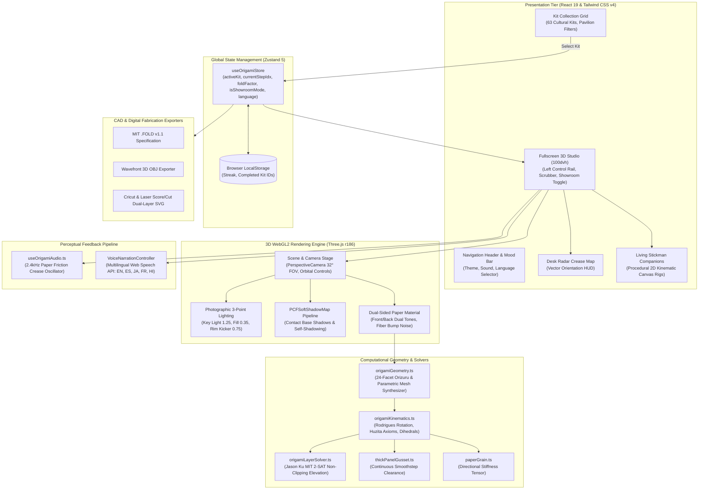

# Project O2: System Architecture & Topology

This document describes the end-to-end software architecture, component topology, state machines, and rendering lifecycles powering **Project O2**.

---

## 1. System Topology Overview



---

## 2. Global State Machine (`useOrigamiStore.ts`)

Global state is managed via **Zustand 5**, ensuring strict reactivity with minimal component re-renders:

```typescript
interface OrigamiStoreState {
  activeKit: OrigamiKit | null;
  currentStepIdx: number;
  foldFactor: number; // Normalized continuous fold progression [0.0, 1.0]
  isFoldAnimating: boolean;
  isAudioMuted: boolean;
  isShowroomMode: boolean; // 360° showroom turntable preview
  language: LanguageCode; // 'en' | 'es' | 'ja' | 'fr' | 'hi'
  completedKitIds: string[];
  streak: number;
  
  // Actions
  setActiveKit: (kit: OrigamiKit) => void;
  setCurrentStepIdx: (idx: number) => void;
  setFoldFactor: (factor: number) => void;
  toggleAudioMute: () => void;
  toggleShowroomMode: () => void;
  setLanguage: (lang: LanguageCode) => void;
  markKitCompleted: (kitId: string) => void;
}
```

### Invariants:
1. `foldFactor` is strictly clamped within $[0.0, 1.0]$.
2. `currentStepIdx` is 0-indexed internally, mapped to 1-based `stepNumber` in UI views.
3. Switching kits resets `foldFactor` to `0.0` and defaults `isShowroomMode` to `true` to present the completed 3D sculpture before folding commences.

---

## 3. 3D WebGL2 Rendering Pipeline (`StudioViewer.tsx`)

The 3D stage utilizes imperative Three.js r186 directly inside a double-buffered HTML5 canvas:

### A. Lighting & Shadow Setup
* **Key Light**: Directional light positioned at `(3.0, 5.0, 4.0)` with intensity `1.25`, color `#fffbf0`, shadow map resolution $1024 \times 1024$, and shadow bias $-0.0003$.
* **Fill Light**: Directional light at `(-3.0, 2.0, -2.0)` with intensity `0.35`, color `#e2e8f0` to eliminate pitch-black under-crease occlusion.
* **Rim / Kicker Light**: Directional light at `(0.0, -2.0, -4.0)` with intensity `0.75`, highlighting paper silhouette edges.
* **Ambient Base**: Hemispherical/ambient illumination at `0.40` for consistent shadow fill.
* **Shadow Pipeline**: `renderer.shadowMap.enabled = true`, using `THREE.PCFSoftShadowMap` with contact shadow reception on `frontMesh`, `backMesh`, and the circular ground plinth.

### B. Procedural Paper Fiber Bump Texture
To eliminate the plastic artificial look of default CG materials, an offscreen $256 \times 256$ canvas procedurally renders high-frequency simplex/perlin noise paper fibers:
* Bump scale: `0.002` units.
* Roughness: `0.72`.
* Metalness: `0.02`.
* Dual-Sided Coloration: Front facet `#ef4444` (Crimson Kami), back facet `#ffffff` (White underside).

---

## 4. Multilingual Speech & Audio Synthesis Pipeline

### A. Perceptual Crease Impulses (`useOrigamiAudio.ts`)
* Uses browser `AudioContext` with an exponential decay envelope.
* Base frequency: $2400\text{ Hz}$ band-pass filtered, simulating the acoustic shear impulse of fingernails running across pressed cellulose fibers.

### B. Localized TTS Engine (`VoiceNarrationController`)
* Supports English (`en`), Spanish (`es`), Japanese (`ja`), French (`fr`), and Hindi (`hi`).
* Prioritizes high-naturalness neural voice synthesizers (e.g. `Microsoft Aria`, `Google US English`, `Google 日本語`).
* Replaces mechanical jargon with intuitive physical metaphors:
  * Diagonal fold $\rightarrow$ *Taco Fold*
  * Corner kite fold $\rightarrow$ *Ice Cream Cone*
  * Inside-reverse crimp $\rightarrow$ *Secret Pocket Crimp*
  * Flap elevation $\rightarrow$ *Fox Ears*

---

## 5. Living Kinematic Canvas Companions (`LivingStickman.tsx`)

Autonomous companions animate across key views without touching the Three.js WebGL context:
* **Physics & IK Model**: 2D inverse kinematics with swinging arm pendulum equations, head tilt springs, and dynamic leg stride oscillators.
* **State Modes**: Idle breathing, curious inspection, cheerful jumping cheer upon fold completion, and pointing guidance toward the next step.
* **Rendering Efficiency**: Direct 2D `<canvas>` rendering at $60\text{ fps}$, consuming $<0.5\%$ CPU overhead.
