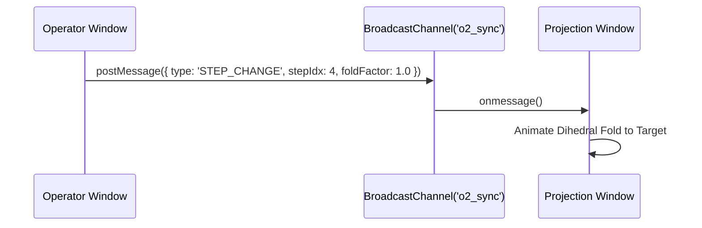

# Project O2: Hardware & Device Setup Guide

This guide details configuration, hardware optimization, dual-screen setups, presentation modes, and input controls for **Project O2**.

---

## 1. Dual-Screen & Foldable Hardware Optimization

Project O2 includes native support for the **W3C Device Posture API** and **CSS Viewport Segments**, adapting its layout dynamically on foldable devices (such as the Microsoft Surface Duo, Samsung Galaxy Z Fold, Google Pixel Fold, and dual-screen laptops).

### A. Supported Device Postures
* **Continuous / Flat Posture**: Standard single-screen layout with the 3D paper stage taking center focus and controls pinned to the ergonomic left rail.
* **Book Posture (Vertical Fold Hinge)**: The application automatically splits along the device hinge:
  * **Screen 1 (Left)**: Full 3D WebGL paper stage with real-time orbital turntable.
  * **Screen 2 (Right)**: 2D Desk Radar vector crease map, step-by-step dihedral instructions, and audio controls.
* **Tent Posture (Tabletop Fold Hinge)**: Screen 1 faces upward with the hands-free 3D origami stage, while Screen 2 provides gross-motor navigation controls for hands-free folding.

### B. CSS Spanning Implementation
The studio automatically triggers dual-screen layout via CSS media queries:
```css
/* Dual horizontal segments (Book Posture) */
@media (horizontal-viewport-segments: 2) {
  .studio-container {
    display: grid;
    grid-template-columns: env(viewport-segment-width 0 0) env(viewport-segment-width 1 0);
    column-gap: env(viewport-segment-left 1 0) - env(viewport-segment-right 0 0);
  }
  
  .studio-3d-stage {
    grid-column: 1;
    width: 100%;
    height: 100dvh;
  }
  
  .studio-controls-pane {
    grid-column: 2;
    overflow-y: auto;
  }
}
```

---

## 2. Presentation & Multi-Display Mode

When deploying Project O2 in auditorium, laboratory, or gallery presentation setups, the application supports a dedicated multi-display synchronization mode.

### A. Activating Presentation Mode
To launch the presentation display, append `?mode=presentation` to the application URL:
```
http://localhost:5175/?mode=presentation
```

### B. Dual-Window Architecture (`BroadcastChannel`)
In presentation mode, two browser windows communicate over a zero-latency browser `BroadcastChannel`:
* **Operator Console (Display 1)**: Displays the full UI controls, step notes, layer elevation sliders, and camera override tools.
* **Public Projector / Audience Display (Display 2)**: Displays an unobstructed, full-screen 4K/60fps 3D paper stage without UI clutter, mirroring camera movements and fold transitions in real time.



---

## 3. Gross-Motor Tactile Hotkeys & Navigation

To facilitate physical paper folding where the user's hands are occupied holding kami sheets, Project O2 provides gross-motor keyboard controls:

| Key Binding | Action | Description |
| :--- | :--- | :--- |
| **Spacebar** | Toggle Animation | Starts or pauses the smooth dihedral fold playback. |
| **Arrow Right** (`→`) | Next Step | Advances to the next fold step and triggers voice narration. |
| **Arrow Left** (`←`) | Previous Step | Reverts to the previous fold step. |
| **R** | Reset Fold | Resets the active fold factor back to flat sheet ($0\%$). |
| **F** | Flip Sheet | Rotates the virtual paper stage $180^\circ$ (Pancake Flip). |
| **M** | Mute / Unmute Audio | Toggles Web Audio creasing impulses and TTS narration. |
| **S** | Showroom 3D Mode | Toggles between 360° Showroom turntable and Step View. |
| **Escape** | Close / Exit | Returns from Studio View to the Kit Collection Grid. |

---

## 4. Audio Hardware & Speech Synthesis Setup

### A. Web Audio Impulse Pipeline
* **Crease Sound Synthesis**: Uses a procedural audio oscillator at $2.4\text{ kHz}$ with high-pass filtering to simulate the physical friction impulse of fingernail-creased Kami paper.
* **Volume Calibration**: Default impulse gain is calibrated to $-12\text{ dBFS}$ to prevent clipping on external speaker monitors.

### B. Web Speech API (TTS) Permissions
* **Browser Policy**: Modern browsers require an initial user gesture (e.g. clicking the `"Begin Folding ▶"` button or `"Read Voice"` toggle) before permitting synthetic speech audio playback.
* **Voice Configuration**: The system automatically queries `window.speechSynthesis.getVoices()` and selects high-fidelity neural voices across English (`en-US`), Spanish (`es-ES`), Japanese (`ja-JP`), French (`fr-FR`), and Hindi (`hi-IN`).
* **Headphone / Hands-Free Operation**: When auto-voice is enabled (`[ 🔊 ]`), each step transition automatically announces the fold operation without needing keyboard or mouse touch.

---

## 5. Troubleshooting Display & Peripheral Issues

1. **Stuttering 3D Frame Rate**:
   * Verify hardware acceleration is active in your browser (`chrome://gpu`).
   * On dual-GPU laptops, ensure the browser is set to utilize the discrete GPU (NVIDIA/AMD) rather than low-power integrated graphics.
2. **Audio Not Playing**:
   * Ensure the tab is not muted in your browser title bar.
   * Verify that an initial user click has occurred to unlock the browser's Web Audio `AudioContext`.
3. **Foldable Spanning Not Detected**:
   * On Chromium browsers, verify that `#enable-experimental-web-platform-features` is enabled in `chrome://flags` if testing on pre-release foldable hardware.
