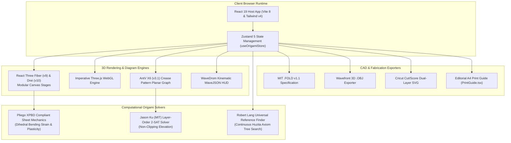

# OrigamiStudio Application Blueprint

## System Overview
OrigamiStudio is the primary web application for Project O2, providing a browser-based computational origami design, 3D simulation, and kinematics platform. Built with React 19, TypeScript, Vite 8, Three.js, React Three Fiber (R3F), and Tailwind CSS v4, it renders authentic physical folding kinetics using Huzita-Hatori axioms, supports 63 complete multi-cultural origami kits across 9 collections, provides 3D showroom turntables with contact shadows, and exports to the MIT FOLD v1.1 open specification, Wavefront OBJ, and Cricut SVG.

## System Architecture

### Build & Tooling Notes
- Built using Vite 8 with Fast HMR and Oxlint linting rules.
- Powered by `@vitejs/plugin-react` and `@tailwindcss/vite`.
- 3D rendering powered by `three`, `@react-three/fiber`, and `@react-three/drei`.
- Crease pattern graph engine powered by `@antv/x6`.
- Verification runner executes strict TypeScript compile checks (`tsc -b`) and Vite production bundle synthesis (`vite build`).

## Local Interface & Invariants
- `vite.config.ts`: Exports default Vite configuration mounting React and Tailwind CSS v4 plugins.
- `package.json`: Defines project dependencies (`three`, `framer-motion`, `lucide-react`, `react`, `react-dom`, `zustand`) and build pipeline scripts (`pnpm dev`, `pnpm build`, `pnpm test`, `pnpm verify:kits`, `pnpm lint`, `pnpm preview`).
- `index.html`: Host HTML document containing root element `#root` and viewport configuration.

## Subdirectories & System Boundaries
- [Source Code (`src`)](./src/README.md) - Primary application source tree grouping domain types, state store, Web Audio & posture hooks, 63-kit database, 3D math and CAD kinematics, design tokens, and React UI components.

## Global Invariants
- Dynamic fold factor `foldFactor` is strictly bounded between `0.0` (unfolded sheet) and `1.0` (fully completed fold) across kinematics engines and 3D viewers.
- 3D vertex coordinates in procedural mesh generators conform to the normalized 2-unit square coordinate boundary $[-1.0, 1.0]$.
- Kit data is strictly typed against `OrigamiKit` and requires continuous step indices starting from step 1.

## Global Side Effects
- Local browser persistence: Writes daily streak records, language preference, theme preference, and completed kit lists to `localStorage`.
- WebGL GPU context: Initializes Three.js WebGL rendering contexts in the browser DOM.
- Web Audio synthesis: Activates the Web Audio API hardware output for procedural paper creasing and chime effects.
- Speech synthesis: Utilizes the browser Web Speech API for multilingual step voice narration.
- Hardware posture: Listens to W3C `devicePosture` changes on foldable devices.

## System Verification
- Run: `pnpm build`
- Run: `pnpm test`
- Run: `pnpm verify:kits`
