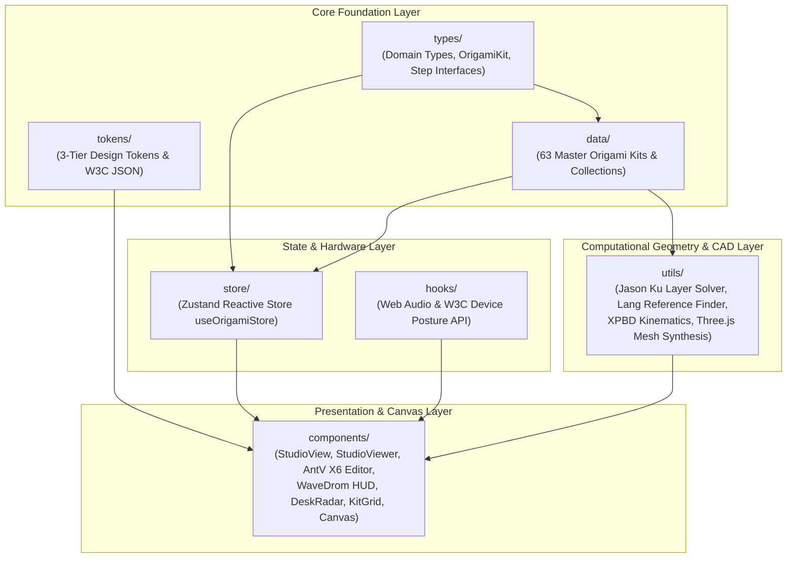

# OrigamiStudio Core Source (`src`)

## Overview
Contains the core frontend application source code for OrigamiStudio, structured into domain types, global state store, procedural audio and hardware posture hooks, 63-kit data catalogs, computational geometry and kinematics utilities, design system tokens, and React 19 UI components.

## Subdirectory Architecture & Data Flow

## Subdirectories & Boundaries
- [Components](./components/README.md) - React UI components including the interactive 3D Studio, declarative R3F canvas stages, AntV X6 crease pattern editor, WaveDrom timing HUD, Robert Lang reference finder modal, 2D Desk Radar, Step Guidance, Kit Grid, and Print Guide.
- [Data](./data/README.md) - Database of 63 computational origami kits (`kits.json`), cultural collections taxonomy, and deterministic daily featured kit selection.
- [Hooks](./hooks/README.md) - Synthetic Web Audio API hooks (paper crease rustle, tactile clicks, victory chime) and W3C Device Posture API foldable hardware sensors.
- [Store](./store/README.md) - Zustand global application state store managing active kit, step navigation, viewer modes, daylight/dark themes, calm mode, and classroom smartboard mode.
- [Tokens](./tokens/index.ts) - 3-Tier Design Token System (Global primitives, Semantic themes, Component & Shorts/AI creative specifications).
- [Types](./types/README.md) - Domain TypeScript interfaces and types for kits, folding steps, paper specifications, cultural collections, and view modes.
- [Utils](./utils/README.md) - Computational geometry core: Jason Ku (MIT) layer-order 2-SAT solver, Robert Lang arbitrary reference finder, XPBD compliant sheet mechanics, procedural Three.js 3D mesh synthesis, MIT FOLD v1.1 exporter, SVG diagrams, and procedural hand rig.
