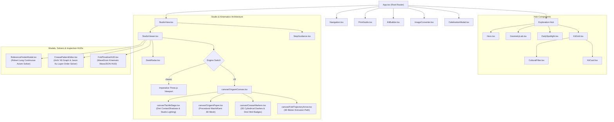

# Origami UI Components Package

## Overview
Houses all React 19 visual interface components for OrigamiStudio, providing the interactive 3D folding studio, declarative React Three Fiber (R3F) canvas modules, AntV X6 planar graph crease pattern theorem editor, WaveDrom kinematic timeline HUD, Robert Lang arbitrary reference finder, 2D desk orientation radar, classroom smartboard mode, catalog browser, print guide exporter, and custom kit builder.

## Component Hierarchy & Architecture

## Interface
- `StudioViewer` [`StudioViewer.tsx`]: Core dual-engine 3D viewport component. Coordinates Three.js / R3F engines, rotational sweep hinge dials, procedural animated hands rig, camera presets, and W3C device posture hardware folding sensors.
- `StudioView` [`StudioView.tsx`]: Top-level studio container coordinating `StudioViewer`, responsive collapsible sidebar (`col-span-12` in smartboard/junior mode), step progress bar, fold factor slider, and `StepGuidance`.
- `ReferenceFinderModal` [`ReferenceFinderModal.tsx`]: Robert Lang arbitrary coordinate reference solver modal. Features an interactive 200x200mm SVG paper canvas: users click any coordinate $(X, Y) \in [0, 1]^2$ to solve fold sequences using continuous Huzita-Hatori tree search (Axioms O1, O2, O4, O5) with physical error $< 0.2\text{ mm}$ and analytical proofs.
- `CreasePatternEditor` [`CreasePatternEditor.tsx`]: AntV X6 2D crease pattern planar graph canvas. Evaluates real-time Kawasaki ($\sum (-1)^i \alpha_i \approx 0^\circ$) and Maekawa ($|M - V| = 2$) local theorems alongside Jason Ku (MIT) global layer-order 2-SAT non-clipping constraint proofs and face elevation offsets ($z_i$).
- `FoldTimelineHUD` [`FoldTimelineHUD.tsx`]: WaveDrom kinematic fold timeline HUD. Generates multi-track WaveJSON timing signals, actuator clocks, and XPBD dihedral strain indicators synchronized with `foldFactor`.
- `DeskRadar` [`DeskRadar.tsx`]: 2D cutting mat orientation radar positioned in the studio viewport. Displays diamond (45°) vs. square (0°) table rotation, dashed crease line preview, underside color exposure hint, and `YOU` vantage anchor.
- `StepGuidance` [`StepGuidance.tsx`]: Instructional step card displaying technical folding directives, educational age-track adaptations, food/animal metaphors, warning callouts, and speech narration controls.
- `KitGrid` [`KitGrid.tsx`]: Responsive 63-kit catalog grid with difficulty, school grade band, and cultural category filtering tabs.
- `KitCard` [`KitCard.tsx`]: Individual kit card component displaying cover preview, metadata tags, and launch actions.
- `DailySpotlight` [`DailySpotlight.tsx`]: Banner highlighting the deterministic daily featured kit and streak tracker.
- `CulturalFilter` [`CulturalFilter.tsx`]: Cultural heritage filter bar (Indian, Japanese, Chinese, American, etc.) with keyword search and school grade band selector.
- `GeometryLab` [`GeometryLab.tsx`]: Computational geometry inspector visualizing the 7 Huzita-Hatori axioms and fold lines.
- `ImageConverter` [`ImageConverter.tsx`]: AI image-to-origami tool allowing photo uploads or webcam capture to synthesize custom crease patterns.
- `KitBuilder` [`KitBuilder.tsx`]: Interactive kit creator interface allowing users to define custom step-by-step origami models with starter kid templates.
- `PrintGuide` [`PrintGuide.tsx`]: Editorial print-optimized A4 layout generator following 4px strict grid and 1px hairlines, producing physical paper sheets with printed fold lines.
- `Navigation` [`Navigation.tsx`]: Primary header bar featuring brand logo, view navigation links, sound toggle, daylight/dark theme toggle, and classroom smartboard mode toggle.
- `CelebrationModal` [`CelebrationModal.tsx`]: Completion modal triggering celebratory confetti animations, harmonic chimes, and printable official Master Diploma with student name.
- `Hero` [`Hero.tsx`]: Track-aware adaptive hero section tailoring headlines and CTAs for Sprouts (5–8), Explorers (9–13), and STEM Champions (14–18).

### Declarative R3F Canvas Modules (`src/components/canvas/`)
- `OrigamiCanvas` [`canvas/OrigamiCanvas.tsx`]: Master R3F container with `<AdaptiveDpr />` (1.0–1.5 FPS guard), `<CameraRig />` (perspective, top, front presets), and calm mode auto-rotation suppression.
- `OrigamiPaper` [`canvas/OrigamiPaper.tsx`]: Procedural washi/kami 3D mesh with dual-sided materials (front model color vs. `#fcfdfd` white underside), anti-glare roughness (0.92), pancake turnover ($180^\circ$ flip), and translucent emerald ghost target silhouette.
- `CreaseMarkers` [`canvas/CreaseMarkers.tsx`]: Yoshizawa-Randlett 3D cylindrical dashed lines (cyan valley, coral mountain) and Drei `<Html />` joint hinge badges (`01`, `02`).
- `FoldTrajectoryArrow` [`canvas/FoldTrajectoryArrow.tsx`]: Continuous 3D quadratic Bézier curve extrusion with traveling arrowhead cone aligned to analytical curve tangents $B'(t)$.
- `TactileStage` [`canvas/TactileStage.tsx`]: Soft contact ground ambient occlusion via Drei `<ContactShadows />` and 3-point studio lighting presets.

## Invariants
- `StudioViewer` binds Three.js render loop to `requestAnimationFrame` and disposes geometries, textures, materials, and dial sprites on component unmount to prevent WebGL memory leaks [`StudioViewer.tsx`].
- `DeskRadar` dynamically calculates paper diamond orientation (`CORNER → CHEST`) vs flat edge orientation (`FLAT EDGE → CHEST`) based on crease line slope and active step metrics [`DeskRadar.tsx`].
- R3F canvas components dynamically query `isCalmMode` and `prefers-reduced-motion` to immediately suspend camera bob and auto-rotation [`OrigamiCanvas.tsx`, `OrigamiPaper.tsx`].

## Side Effects
- DOM canvas mounting: Mounts WebGL context via Three.js / R3F into container `div` [`StudioViewer.tsx`, `canvas/OrigamiCanvas.tsx`].
- Confetti generation: Invokes `canvas-confetti` during completion celebration [`CelebrationModal.tsx`].
- Window resizing: Listens to `window.addEventListener('resize')` to adjust camera aspect ratio and renderer pixel dimensions [`StudioViewer.tsx`].

## Verification
- Run: `pnpm build`
- Run: `node --experimental-strip-types scripts/verifyLayerSolverAndReferenceFinder.js`
