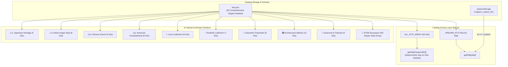

# Origami Data & Kit Catalog Package

## Overview
Houses the complete 63-kit computational origami model database (`kits.json`), cultural collection taxonomy records, and dynamic kit retrieval functions supporting deterministic daily featured rotations, school grade bands, and custom user-built models.

## Catalog Taxonomy & Retrieval Architecture

## Interface
- `ORIGAMI_KITS` [`kits.ts:ORIGAMI_KITS`]: Map of all 63 pre-compiled origami kits keyed by unique kit identifier string (including Kit #63 `aerospace-01`).
- `ALL_KITS_ARRAY` [`kits.ts:ALL_KITS_ARRAY`]: Flat array containing all 63 loaded `OrigamiKit` objects for iterative filtering, search indexing, and pagination.
- `COLLECTIONS` [`kits.ts:COLLECTIONS`]: Array of 9 `CulturalCollection` records defining cultural heritage pavilions (Indian, Japanese, Chinese, American, Lotus, Butterfly, Geometric, Nativity, Holiday).
- `getKitById(id: string): OrigamiKit | undefined` [`kits.ts:getKitById`]: Fetches kit data by ID, with dynamic fallback to session storage when querying `'custom'`.
- `getDailyFeaturedKit(): OrigamiKit` [`kits.ts:getDailyFeaturedKit`]: Returns a deterministic daily featured model computed from the current calendar year and day-of-year index:
  $$\text{dayOfYear} = \lfloor(T_{\text{now}} - T_{\text{startOfYear}}) / 86400000\rfloor$$
  $$\text{featuredIndex} = \text{dayOfYear} \pmod{\text{ALL\_KITS\_ARRAY.length}}$$

## Invariants
- `kits.json` contains exactly 63 fully certified origami kits, each containing valid title, category, difficulty tier, tools, paper specs, and sequential step instructions [`kits.json`].
- `getKitById('custom')` returns parsed custom kit data from `sessionStorage` if present, falling back to `undefined` if storage is empty or invalid JSON [`kits.ts:getKitById`].
- `getDailyFeaturedKit()` always returns a valid kit, falling back to `ALL_KITS_ARRAY[0]` if index calculations exceed bounds [`kits.ts:getDailyFeaturedKit`].

## Side Effects
- Browser session storage access: Reads `sessionStorage.getItem('origami_custom_kit')` on custom kit requests [`kits.ts:getKitById`].

## Verification
- Run: `pnpm build`
- Run: `npx tsx scripts/verifyAll62Kits.ts`
