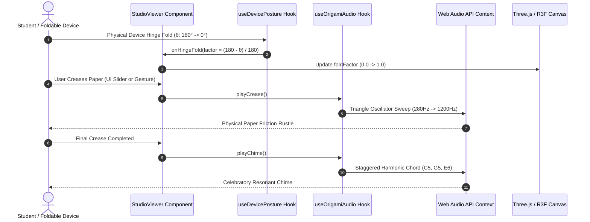

# Origami Audio & Hardware Sensor Hooks Package

## Overview
Provides synthetic Web Audio API procedural sound generation and W3C Device Posture hardware integration for OrigamiStudio. Generates realistic physical paper creasing audio cues, interface click tones, and completion harmonic chords without external audio asset downloads, while bridging physical foldable hardware devices directly to 3D folding simulation.

## System Interaction & Event Architecture

## Interface
- `useOrigamiAudio` [`useOrigamiAudio.ts`]: Custom React hook returning procedural audio triggering functions:
  - `playCrease()`: Synthesizes a paper folding/creasing sound using a triangle oscillator (280 Hz to 1200 Hz sweep) routed through a 750 Hz bandpass filter with exponential gain decay.
  - `playStepClick()`: Generates a soft tactile navigation click using a 880 Hz to 440 Hz sine sweep.
  - `playChime()`: Triggers a resonant 3-note harmonic completion chord (C5 523.25 Hz, G5 783.99 Hz, E6 1318.51 Hz) with staggered start times and 2.2-second decay.
- `useDevicePosture` [`useDevicePosture.ts`]: Custom React hook connecting the W3C Device Posture API:
  - Detects hardware posture types (`'continuous' | 'folded' | 'half-folded'`).
  - Monitors physical hinge angles $\theta \in [0^\circ, 180^\circ]$ from dual-screen foldable phones, tablets, or convertible laptops (e.g. ThinkPad X1 Fold, Asus Zenbook Fold).
  - Automatically calculates normalized fold progress:
    $$\text{postureFoldFactor} = \max\left(0, \min\left(1, \frac{180^\circ - \theta}{180^\circ}\right)\right)$$
  - Triggers optional `onHingeFold` callback to dynamically synchronize 3D paper folding with physical device manipulation.

## Invariants
- Audio playback immediately aborts if `soundEnabled` in `useOrigamiStore` is false [`useOrigamiAudio.ts:soundEnabled`].
- An `AudioContext` singleton is lazily created on user interaction and automatically resumed if found suspended by browser autoplay policies [`useOrigamiAudio.ts:initCtx`].
- `useDevicePosture` safely checks for `navigator.devicePosture` availability, gracefully degrading to static controls on standard non-folding desktop hardware without runtime exceptions [`useDevicePosture.ts`].

## Side Effects
- Web Audio API operations: Creates oscillators, gain nodes, and biquad filters connected to `AudioContext.destination` [`useOrigamiAudio.ts:playCrease`, `useOrigamiAudio.ts:playStepClick`, `useOrigamiAudio.ts:playChime`].
- Device Posture Event Listeners: Attaches `navigator.devicePosture.addEventListener('change')` to monitor physical hardware angles [`useDevicePosture.ts`].

## Verification
- Run: `pnpm build`
