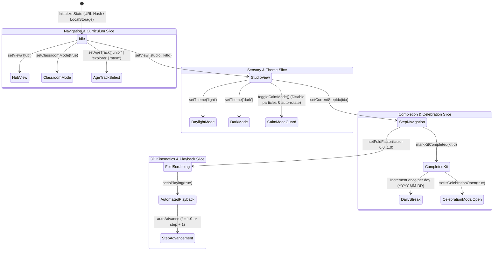

# Origami State Store Package

## Overview
Provides global client-side application state management for OrigamiStudio using Zustand. Coordinates active kit selection, folding step progression, 3D/CP viewer modes, sound toggles, daylight/dark theme transitions, calm mode sensory guards, playback loops, classroom smartboard mode, educational age tracks, and persistent daily completion streaks.

## State Lifecycle & Architecture

## Interface
- `useOrigamiStore` [`useOrigamiStore.ts`]: Primary Zustand store hook exposing reactive state and setter actions across all components.
- `AgeTrack` [`useOrigamiStore.ts`]: Educational age track union (`'junior' | 'explorer' | 'stem'`).
- `SchoolGradeFilter` [`useOrigamiStore.ts`]: School hub grade band union (`'all' | 'sprouts' | 'explorers' | 'stem'`).
- `ViewMode` [`../types/origami.ts`]: Navigation view routing (`'hub' | 'pavilions' | 'studio' | 'image-to-origami' | 'kit-builder' | 'print-guide'`).

### State Properties
- `currentView`: Active page route view (`ViewMode`).
- `activeKitId`: Currently active origami model identifier string (defaults to `'japanese-01'`).
- `currentStepIdx`: Active zero-indexed step index within active kit.
- `completedStepIndices`: Set of completed step numbers for the active session.
- `foldFactor`: Normalized fold progress between `0.0` (unfolded) and `1.0` (folded).
- `viewerMode`: Active viewport mode (`'3d'` Three.js/R3F stage or `'cp'` 2D crease pattern SVG).
- `soundEnabled`: Global Web Audio sound effects toggle boolean.
- `ageTrack`: Active curriculum mode (`'junior'` Sprouts 5–8, `'explorer'` Explorers 9–13, `'stem'` Champions 14–18).
- `schoolGradeFilter`: Active filter band on the Exploration Hub.
- `isClassroomMode`: Smartboard fullscreen layout flag.
- `isSpeaking`: Active Web Speech speech synthesis status.
- `activeCultureFilter`: Active cultural pavilion category.
- `searchQuery`: Text search filter query.
- `dailyStreak`: Consecutive days completion counter.
- `completedKitIds`: Array of unique kit IDs completed by user.
- `isCelebrationOpen`: Victory celebration modal visibility.
- `isCalmMode`: WCAG 2.1 SC 2.3.3 vestibular motion guard disabling confetti particles and continuous auto-rotation.
- `theme`: Theme state (`'light'` Daylight Craft Paper or `'dark'` Studio Dark).
- `isLooping`: Continuously replay fold trajectory animation when step completes.
- `autoAdvance`: Automatically advance to the subsequent step when `foldFactor` reaches 1.0.
- `playbackSpeed`: Kinetic playback velocity multiplier (`0.2` Turtle, `1.0` Normal, `2.0` Fast).
- `isPlaying`: Automated kinetic animation playhead state.

### Actions
- `setView(view, kitId?)`: Switches active view mode, synchronizes URL hash, resets step progress to 0, and closes celebration modal.
- `setActiveKitId(id)`: Selects active kit and resets folding progression to step 0.
- `setCurrentStepIdx(idx)`: Sets active step index.
- `toggleStepCompleted(idx)`: Toggles completion state for step index.
- `setFoldFactor(factor)`: Updates fold factor progress between `0.0` and `1.0`.
- `setViewerMode(mode)`: Toggles between 3D studio and 2D CP view.
- `toggleSound()`: Inverts `soundEnabled`.
- `setAgeTrack(track)`: Updates curriculum age track and persists to `localStorage`.
- `setSchoolGradeFilter(filter)`: Sets school curriculum filter band.
- `setClassroomMode(active)`: Toggles smartboard presentation mode.
- `setIsSpeaking(speaking)`: Sets speech synthesis status.
- `setActiveCultureFilter(filter)`: Sets cultural pavilion filter.
- `setSearchQuery(query)`: Sets search query string.
- `markKitCompleted(kitId)`: Adds kit to completed set, checks daily streak date, persists to `localStorage`, and opens celebration modal.
- `setIsCelebrationOpen(open)`: Toggles celebration modal visibility.
- `toggleCalmMode()` / `setCalmMode(calm)`: Toggles vestibular motion guard.
- `toggleTheme()` / `setTheme(theme)`: Switches Daylight Craft (`#faf8f5`) and Studio Dark (`#0c0a09`) themes, updating HTML `data-theme` attribute and `localStorage`.
- `toggleLooping()`: Toggles continuous step replay.
- `setAutoAdvance(advance)`: Toggles automatic step transition upon fold completion.
- `setPlaybackSpeed(speed)`: Sets fold animation speed multiplier.
- `setIsPlaying(playing)`: Toggles kinetic playback animation state.

## Invariants
- Default fallback kit ID is `'japanese-01'` when URL hash or state lookup is empty [`useOrigamiStore.ts:getInitialState`].
- Switching active kit or view automatically resets `currentStepIdx` to 0, clears `completedStepIndices`, sets `foldFactor` to 1.0, and closes `isCelebrationOpen` [`useOrigamiStore.ts:setView`, `useOrigamiStore.ts:setActiveKitId`].
- `dailyStreak` increments at most once per calendar day (ISO date string `YYYY-MM-DD`) upon kit completion [`useOrigamiStore.ts:markKitCompleted`].
- `theme` synchronization updates DOM `document.documentElement.setAttribute('data-theme', theme)` and `document.documentElement.classList` [`useOrigamiStore.ts:setTheme`].

## Side Effects
- Browser URL hash mutations: Updates `window.location.hash` on route transitions [`useOrigamiStore.ts:setView`].
- Viewport scroll: Calls `window.scrollTo({ top: 0, behavior: 'smooth' })` on view changes [`useOrigamiStore.ts:setView`].
- Local storage persistence: Reads and writes `origami_completed_kit_ids`, `origami_daily_streak`, `origami_age_track`, `origami_theme`, and `origami_last_completed_date` [`useOrigamiStore.ts`].

## Verification
- Run: `pnpm build`
