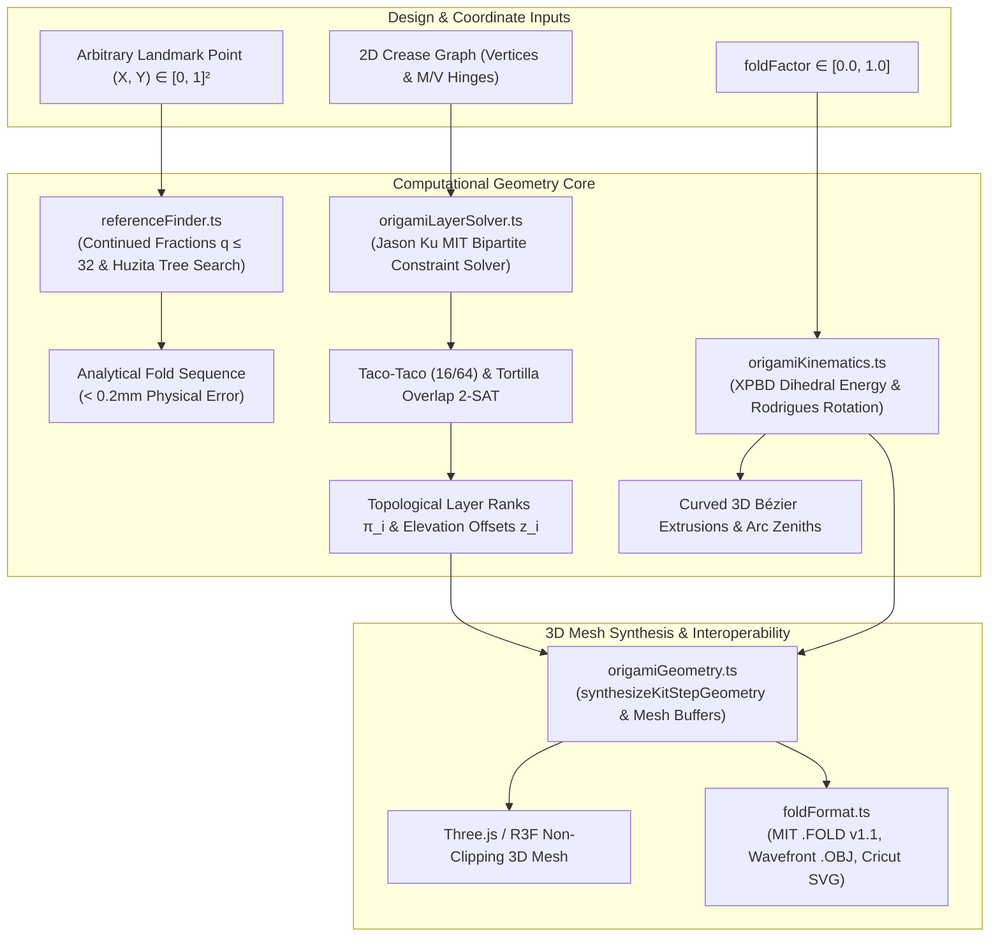

# Computational Origami Utilities Package

## Overview
Implements mathematical origami geometry synthesis, Jason Ku (MIT) global layer-order and flat-foldability constraint solving, Robert Lang universal arbitrary coordinate reference solving, Pliego XPBD compliant sheet mechanics, Huzita-Hatori fold kinematics, MIT FOLD v1.1 interoperability, 2D vector diagram generation, procedural 3D hand rigs, and educational narration controllers.

## Computational Geometry & Kinematics Pipeline

## Interface

### Global Layer-Order & Flat-Foldability Solver (`origamiLayerSolver.ts`)
- `solveGlobalLayerOrder(faces: FacePolygon[], hinges: CreaseHinge[], paperThickness?: number): LayerOrderResult` [`origamiLayerSolver.ts:solveGlobalLayerOrder`]: Evaluates polygon intersections using Shoelace area and Ray-Casting, enforces Taco-Taco (16/64 non-clipping assignments) and Taco-Tortilla boundary constraints, and executes topological sorting to assign layer ranks $\pi_i$ and physical non-clipping elevation offsets $z_i = \pi_i \times \delta_{\text{thickness}}$.
- `polygonArea2D(points: [number, number][]): number` [`origamiLayerSolver.ts:polygonArea2D`]: Shoelace formula for polygon area.
- `isPointInPolygon(point: [number, number], vs: [number, number][]): boolean` [`origamiLayerSolver.ts:isPointInPolygon`]: Ray-casting point-in-polygon containment test.
- Types: `FacePolygon`, `CreaseHinge`, `CreaseAssignment`, `LayerOrderResult` [`origamiLayerSolver.ts`].

### Universal Arbitrary Reference Finder (`referenceFinder.ts`)
- `solveArbitraryReferencePoint(target: { x: number; y: number }): ReferenceSolution` [`referenceFinder.ts:solveArbitraryReferencePoint`]: Solves any arbitrary landmark coordinate $(X, Y) \in [0, 1]^2$ on an origami sheet by calculating best rational approximations via continued fractions ($q \le 32$) and running a depth-bounded Huzita-Hatori axiom tree search (Axioms O1, O2, O4, O5). Guarantees physical error $< 0.2\text{ mm}$ on a 200mm sheet and returns human-readable folding instructions and crease equations.
- `solveReferenceLandmarks(): Record<string, ReferenceSolution>` [`referenceFinder.ts:solveReferenceLandmarks`]: Generates analytical Huzita-Hatori solutions for standard edge divisions ($1/3, 1/5, 1/7$) and geometric angles ($15^\circ, 22.5^\circ, 67.5^\circ, 1/\sqrt{2}$).
- Types: `ReferenceTarget`, `ReferenceStep`, `ReferenceSolution` [`referenceFinder.ts`].

### Geometry Synthesis (`origamiGeometry.ts`)
- `synthesizeKitStepGeometry(kitId: string, stepIdx: number, foldProgress: number): THREE.BufferGeometry` [`origamiGeometry.ts:synthesizeKitStepGeometry`]: Constructs dynamic 3D meshes for any step with interpolated fold progress, non-clipping layer elevations, and recalculated vertex normals.
- `synthesizeKitGeometry(kitId: string, foldProgress: number): THREE.BufferGeometry` [`origamiGeometry.ts:synthesizeKitGeometry`]: Generates finalized 3D mesh model for a kit (including Kit #63 `aerospace-01` ruled hypar surface).
- Procedural primitives: `addTri`, `addQuad`, `addBox`, `addCone`, `addCylinder` [`origamiGeometry.ts`].

### Kinematics & Axioms (`origamiKinematics.ts`)
- `calculateStepPlanMetrics(kitId: string, stepIdx: number, totalSteps: number, foldFactor: number): StepPlanMetrics` [`origamiKinematics.ts:calculateStepPlanMetrics`]: Solves crease line coordinates, dihedral angles, mobile flap rotation matrices, Kawasaki flat-foldability sums, Maekawa parity, and Huzita-Hatori axiom classifications.
- `calculateCompliantSheetMechanics(hingeAngleDeg: number, foldProgress: number): CompliantSheetState` [`origamiKinematics.ts:calculateCompliantSheetMechanics`]: Pliego-inspired XPBD dihedral bending energy, plasticity yield threshold ($150^\circ$), and physical spring-back angle ($3^\circ\text{--}5^\circ$).
- `calculateSpringDampedProgress(t: number): number` [`origamiKinematics.ts:calculateSpringDampedProgress`]: Critically damped harmonic oscillator easing for paper stiffness.
- Types: `StepPlanMetrics`, `MobileFlap`, `CompliantSheetState`, `HuzitaAxiom`, `TrajectoryArc` [`origamiKinematics.ts`].

### CAD & Standard Interoperability (`foldFormat.ts`)
- `generateFoldData(kit: OrigamiKit, stepIdx: number, foldFactor?: number): FoldFile` [`foldFormat.ts:generateFoldData`]: Exports MIT FOLD v1.1 specification JSON object.
- `downloadFoldFile(kit: OrigamiKit, stepIdx: number, foldFactor?: number)` [`foldFormat.ts:downloadFoldFile`]: Triggers browser download of `.fold` file.
- `generateObjString(geo: THREE.BufferGeometry, title?: string): string` [`foldFormat.ts:generateObjString`]: Serializes Three.js buffer geometry to Wavefront OBJ format.
- `downloadObjFile(kit: OrigamiKit, geo: THREE.BufferGeometry, stepIdx: number)` [`foldFormat.ts:downloadObjFile`]: Triggers browser download of `.obj` 3D model.
- `generateCricutSvg(kit: OrigamiKit, stepIdx: number): string` [`foldFormat.ts:generateCricutSvg`]: Produces dual-layer Cricut score (dashed red) and cut (black outline) SVG.
- `downloadCricutSvg(kit: OrigamiKit, stepIdx: number)` [`foldFormat.ts:downloadCricutSvg`]: Triggers browser download of Cricut-ready SVG.
- `COMPUTATIONAL_PRESETS` [`foldFormat.ts:COMPUTATIONAL_PRESETS`]: Pre-calculated parametric origami models.

### 2D Diagram Renderer (`origamiDiagramRenderer.ts`)
- `generateStepIllustrationData(...)` [`origamiDiagramRenderer.ts:generateStepIllustrationData`]: Builds SVG polygon paths, multi-flap motion vectors, and crease lines for 2D instructional step cards.
- `generatePrintablePaperSheetData(...)` [`origamiDiagramRenderer.ts:generatePrintablePaperSheetData`]: Produces A4 printable cut-and-fold template polygons.
- `getStepBasePolygon(...)` [`origamiDiagramRenderer.ts:getStepBasePolygon`]: Computes base silhouette polygon for any step.
- `getKitThemeColor(kitId: string, defaultColor?: string): string` [`origamiDiagramRenderer.ts:getKitThemeColor`]: Resolves theme accent color.

### Procedural Hands Rig (`origamiHands.ts`)
- `createOrigamiHandsRig(): HandsRig` [`origamiHands.ts:createOrigamiHandsRig`]: Assembles left and right procedural low-poly hand groups with articulated fingers.
- `updateHandsPose(hands: HandsRig, metrics: StepPlanMetrics, progress: number, visible: boolean)` [`origamiHands.ts:updateHandsPose`]: Positions hands along the crease line to demonstrate human pinch-and-crease gestures.

### Educational & Voice Narration (`schoolOrigami.ts`)
- `getSchoolStepProfile(step: OrigamiStep, ageTrack: AgeTrack): SchoolStepProfile` [`schoolOrigami.ts:getSchoolStepProfile`]: Adapts technical instructions into grade-appropriate curriculum (Sprouts K-2, Explorers 3-5, STEM 6+).
- `schoolVoice` [`schoolOrigami.ts:schoolVoice`]: Singleton `VoiceNarrationController` providing text-to-speech audio guidance using the Web Speech API.

## Invariants
- Fold coordinate space is normalized to standard square bounds $[-1.0, 1.0]$ with center at `(0, 0)` [`foldFormat.ts`, `origamiKinematics.ts`].
- Mesh synthesis guarantees `computeVertexNormals` is executed to ensure proper dynamic Three.js lighting and shadow casting [`origamiGeometry.ts`].
- Layer ordering solver outputs a valid acyclic topological order for all flat-foldable crease patterns or flags specific Taco-Taco/Tortilla intersection cycles [`origamiLayerSolver.ts`].

## Side Effects
- File downloads: `downloadFoldFile`, `downloadObjFile`, and `downloadCricutSvg` construct temporary DOM `<a>` elements and invoke `URL.createObjectURL` and `a.click()` [`foldFormat.ts`].
- Speech synthesis: `schoolVoice.speak()` invokes browser `window.speechSynthesis` [`schoolOrigami.ts`].

## Verification
- Run: `pnpm build`
- Run: `node --experimental-strip-types scripts/verifyLayerSolverAndReferenceFinder.js`
- Run: `npx tsx scripts/verifyAll62Kits.ts`
